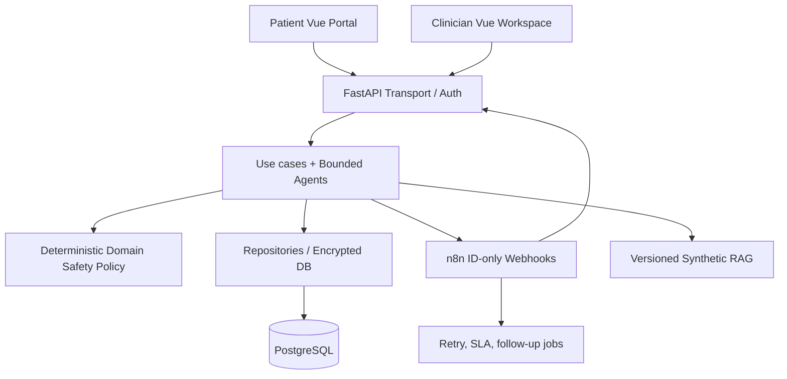

# Clean Architecture and migration boundary

## System goal

A synthetic-data case-coordination platform, not a healthcare decision device. Model outputs may suggest drafts and aid documentation; only human-authorized actors control simulated publication and clinical task status.

## Contexts and ownership

- **Clinical case orchestration:** existing v1–v4 API and agent service. Legacy compatibility façade in `legacy_api.py`; application writes state and audits in a transaction.
- **Communications:** pure `domain.py` policies; `service.py` orchestrates use-cases and safe transitions; `repository.py` encrypts and stores data; `api.py` defines role-scoped HTTP contracts. No model writes directly to this module.
- **n8n:** coordinates scheduled retries and calls opaque case IDs only. It cannot decide to bypass the Safety Gate and cannot send patient content.
- **FHIR:** synthetic R4 sandbox adapter with strict allowed fields; not an EHR authorization proxy.
- **Identity:** external OIDC verifier optional; patient-scoped backend assignment; demo JWT only for local workshops.

## Explicit design decisions

1. Clinical content and images must not be embedded in n8n execution logs or webhook payloads.
2. Agents provide evidence and drafts, never directly mutate clinical orders, medications or approval status.
3. Fail-closed when model, retrieval, or data evidence is missing.
4. Durable outbox, idempotence, atomic transitions, two-party handoffs, and human-owned escalation.
5. Publish only fixed-template, non-treatment, synthetic **in-app** content. Human approval required. An ACK event never closes a clinical case.
6. Backend authorization, not the frontend or n8n expression, decides patient-scoped actions.
7. AI model version, evaluated dataset and RAG evidence need explicit provenance before any supervised clinical pilot.

## Clean architecture limitations

The new communications bounded context follows a clean layering model. Existing agents, orchestration and operational modules predate this design and are encapsulated behind a backward-compatible HTTP adapter. Fully decomposing `legacy_api.py`, replacing SQLite-compat SQL, employing per-request DB connections, and integrating an IAM/PHI-compliant secure stack are **not completed** and are required before considering a real pilot.
