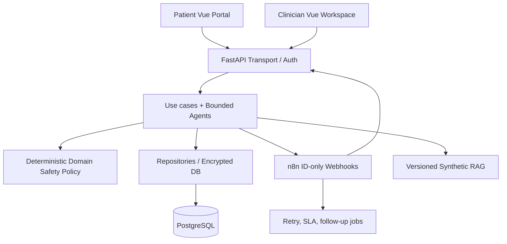

# Clean Architecture and migration boundary

## System goal

A synthetic-data case-coordination platform, not a healthcare decision device. Model outputs may suggest drafts and aid documentation; only human-authorized actors control simulated publication and clinical task status.

## Contexts and ownership

- **Clinical case orchestration:** existing v1–v4 API and agent service. Legacy compatibility façade in `legacy_api.py`; application writes state and audits in a transaction.
- **Communications:** pure `domain.py` policies; `service.py` orchestrates use-cases and safe transitions; `repository.py` encrypts and stores data; `api.py` defines role-scoped HTTP contracts. No model writes directly to this module.
- **n8n:** coordinates scheduled retries and calls opaque case IDs only. It cannot decide to bypass the Safety Gate and cannot send patient content.
- **FHIR:** synthetic R4 sandbox adapter with strict allowed fields; not an EHR authorization proxy.
- **Identity:** external OIDC verifier optional; patient-scoped backend assignment; demo JWT only for local workshops.

## Explicit design decisions

1. Clinical content and images must not be embedded in n8n execution logs or webhook payloads.
2. Agents provide evidence and drafts, never directly mutate clinical orders, medications or approval status.
3. Fail-closed when model, retrieval, or data evidence is missing.
4. Durable outbox, idempotence, atomic transitions, two-party handoffs, and human-owned escalation.
5. Publish only fixed-template, non-treatment, synthetic **in-app** content. Human approval required. An ACK event never closes a clinical case.
6. Backend authorization, not the frontend or n8n expression, decides patient-scoped actions.
7. AI model version, evaluated dataset and RAG evidence need explicit provenance before any supervised clinical pilot.

## Clean Architecture migration status (v3.2)

- **Domain:** `domain/patient_scope.py` and `domain/workflow_rules.py` define patient scope, urgent symptom flags, mandatory tool rules and approval invariants without HTTP or persistence imports.
- **Application:** `application/clinical_cases.py`, `agent_execution.py`, `dispatch_operations.py` and `access_administration.py` own the migrated clinical workflow, agent execution, operational recovery and access assignment. Previously migrated monitoring, FHIR, handoffs, case-query and engagement application services are retained.
- **Presentation:** HTTP adapters in `presentation/routers/` own all 59 inherited API method/path contracts and map typed business failures to HTTP errors. The authentication dependencies remain in `presentation/auth.py`.
- **Infrastructure:** encrypted SQL store and PostgreSQL adapter under `infrastructure/persistence/`, synthetic check-in and DB health readers, outbound case/check-in ID-only dispatchers. The previous `app.store`, `app.postgres_compat` and `app.legacy_api` names are compatibility imports/entrypoints.
- **Composition root:** `legacy_api.py` has no route implementation; only dependency composition and router registration remain. It is still named `legacy_api.py` to preserve imports.
- **Compatibility:** exact 59 method/path pairs are frozen in `contracts/api_routes_v3_1.json` and checked in tests. All 15 n8n JSON workflows remain byte-identical to v3.1.
- **Quality gate:** `scripts/check_architecture.py` checks 13 migrated domain/application modules for forbidden adapter/framework dependencies.

See [v3.2 refactor record](REFACTOR_3_2.md) and [verification status](RELEASE_VALIDATION_3_2.md).

## Clean Architecture limitations

The route-layer migration is complete, **not** the entire application's persistence refactor. `coordination.py`, `operations23.py`, `engagement24.py`, `fhir_bridge.py` and `communications/repository.py` still combine transaction/data access and orchestration. They should be split into repository adapters plus application/domain services with live DB transaction checks. The SQLite-compatible PostgreSQL driver is educational, not a production pooled data access layer. Live OIDC, n8n execution, PostgreSQL, frontend build, model inference and clinical outcome validation are still out of scope of offline verification.
