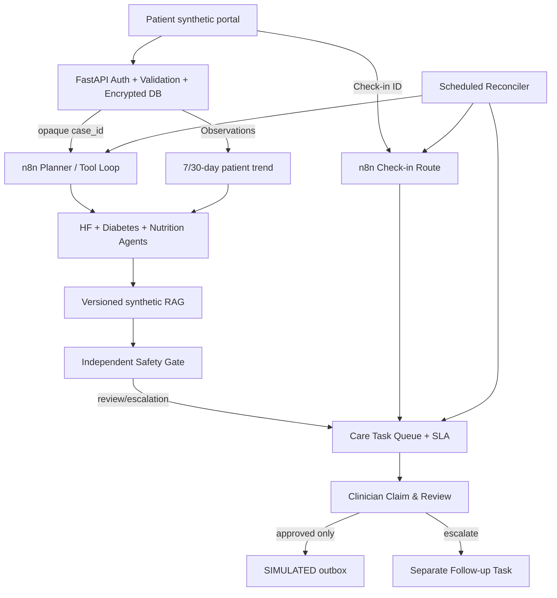

# Hospital-at-Home Care Coordination 2.1 — 產品規格與階段實作（繁體中文）

**範圍**：以 CA6117 Group 14 Proposal 的心衰竭與糖尿病共病、穿戴量測、餐點影像、LLM Agents、RAG 與醫護人員審核為核心。這是 **synthetic-only 可執行研究原型**，不作臨床診斷、不保證 24/7 監控、不會實際寄送訊息。所有臨床風險閾值均需另行驗證；程式中的設定只是教學示範。

## 1. 成功定義、角色與設計界線

- **患者**：上傳 synthetic 生命徵象、餐點、Symptoms Check-in，查看自己資料的趨勢、對模擬訊息做示範回執。
- **臨床人員**：接取臨床審核或 follow-up 任務，查看原始證據與不確定性，記錄核准／拒絕／升級理由，確認後續任務進度。
- **系統管理員（未實作）**：核准指南版本、設定值班班表、監控安全事件、覆核模型版本。
- **n8n**：接收不含病歷的 case/event ID、協調 LLM 工具、定期執行 SLA/missingness/watchdog/retry 工作。
- **FastAPI**：認證、資料、版本、授權、獨立安全規則、照護任務狀態管理；不能以 prompt 取代程式規則。
- **LLM**：僅寫分析草稿，永不具有開藥或直接向患者發送指示的權限。

## 2. 功能優先順序（MoSCoW）

| ID | 功能 | 優先級 | 2.1 狀態 | 原因 / 驗收要求 |
|---|---|---|---|---|
| F01 | 觀測資料（Observation）與患者範圍驗證 | P0 Must | **已實作** | 同一事件只存一次、錯誤單位/時間不可入庫、payload 加密 |
| F02 | 長期趨勢與 7–30 天摘要 | P0 Must | **已實作** | 使用真實觀測筆數和個人時間序列，不補不存在的數據 |
| F03 | 症狀 Check-in + 掉線補處理 | P0 Must | **已實作** | 症狀旗標轉人工任務；n8n 掉線時仍可透過 reconciler 處理 |
| F04 | 臨床任務 Queue、接單權限及 SLA | P0 Must | **已實作** | 未接單不可核准、不同人不可覆寫、逾時有唯一事件 |
| F05 | 矛盾 Safe Stop、獨立 Review Gate | P0 Must | **沿用 + 強化** | 高風險案件禁止 Approve；臨床人員可升級處置但不繞過規則 |
| F06 | 升級後的 Follow-up Task | P0 Must | **已實作** | Escalate 後仍有獨立待辦；unable_to_reach 不可被記成結案 |
| F07 | 七日監測+任務 Dashboard | P1 Should | **已實作基礎版** | 顯示安全旗標、來源、任務、負責人、時間和觀測趨勢 |
| F08 | 多代理 Planner、HF/Diabetes/Nutrition、RAG | P0 Must | **延續原版** | 真模型 API Key 才能執行；缺金鑰 fail closed；Synthetic KB |
| F09 | 病人回執、通知 Outbox | P1 Should | **僅模擬** | API 明確回應 `message_delivered=false`，不得宣稱有真發送 |
| F10 | 事件補送與 SLA 巡檢 | P1 Should | **已實作基礎版** | 案件在 RECEIVED 停留可重送 webhook，重放仍需版本/狀態驗證 |
| F11 | FHIR R4 synthetic bridge + 未來正式 EHR / mapping | P1 Should | **部分實作** | Synthetic Observation Bundle import/export、LOINC/UCUM + 冪等已完成；遠端 EHR OAuth、Patient/Practitioner mapping、Condition/Medication/CarePlan 尚未完成 |
| F12 | 正式指南管理、版本審核、撤銷及臨床 RAG 檢驗 | P1 Should | **尚未實作** | 不能用 synthetic guidance 作真醫療證據 |
| F13 | PostgreSQL、Redis Queue、OIDC、KMS、TLS、RLS | P1/P2 | **僅目標設計** | 多使用者/多實例/安全部署必需，不能宣稱已具備 |
| F14 | 真正的雙向通知與值班排班/Pager | P1/P2 | **尚未實作** | 需病人授權、身分確認、收件回執、失敗重試與人力流程 |
| F15 | 臨床效益/偏誤/漂移與前瞻性評估 | P2 | **測試骨架** | 測敏感度、警報量、交接延遲、跨族群表現，不能用離線測試取代 |

## 3. 架構與狀態機

- **案件** `RECEIVED → PROCESSING → AWAITING_CLINICIAN | ESCALATION_REQUIRED | TECHNICAL_REVIEW → APPROVED_SIMULATED | REJECTED | ESCALATED`。
- **Clinical Review Task** `OPEN → ACKNOWLEDGED → COMPLETED`。未 Claim 即使拿到 clinician JWT 也不能審核。
- **Follow-up Task** `OPEN → ACKNOWLEDGED → COMPLETED` 或 `unable_to_reach → OPEN`。可重新接單，不當作完成。
- **Check-in** `PENDING → TRIAGED`；若 n8n 不可用，15 分鐘巡檢補處理。急迫症狀會產生人工任務，**不是對患者發出自動醫療指示**。
- **Missingness**：只有臨床人員建立 monitoring plan 才會檢查 expected reading gap；一日內同一患者/量測類型僅一張新的缺資料任務。

## 4. 資料庫設計

**目前已執行（SQLite）**：保留 `cases`, `audit`, `knowledge`, `outbox`；新增 `observations`, `checkins`, `monitoring_plans`, `care_tasks`, `patient_receipts`。Observations 和 Check-ins 的值與文字使用 Fernet 在應用端加密，SQL 可查的欄位限合成 ID、代碼、時間戳記、流程狀態。Audit HMAC 鏈可偵測部分修改，但不是不可竄改的 WORM/外部錨定日誌。

**未來 PostgreSQL 目標（設計，不是已部署）**：參見 [`database/postgres_target_schema.sql`](../database/postgres_target_schema.sql)，正規化成 `patients → care_episodes → observations/checkins/cases → agent_runs/evidence_refs → care_tasks/task_events → outbox → audit_events`。因為真實系統必須支援多實例併發、團隊授權、每一回合 AI 輸入版本追蹤和行動結果可稽核。

### 核心 API（本版已實作）

| Method | Path | 身分 | 用途 |
|---|---|---|---|
| POST | `/v2/observations` | patient scoped | 合成量測、idempotency、單位/時間驗證 |
| GET | `/v2/patients/{patient_ref}/trends?days=7` | clinician / owner patient | 觀測趨勢摘要 |
| POST | `/v2/checkins` | patient scoped | 接收症狀 self-report，產生 PENDING event |
| POST | `/v2/monitoring-plans` | clinician | 建立缺失數據檢查的示範規劃 |
| GET | `/v2/tasks` | clinician | 查看任務清單與 SLA |
| POST | `/v2/tasks/{task_id}/claim` | clinician | 接單，同一任務只許一個人 |
| POST | `/v2/tasks/{task_id}/resolve` | owning clinician | 記錄非 clinical_review 任務處置 |
| POST | `/v1/decisions` | owning clinician | 閱讀後核准/拒絕/升級，必須已接單 |
| POST | `/v2/patient/receipt` | owner patient | **只標記模擬回執**，不代表訊息已實際送達 |
| POST | `/internal/checkin/triage` | internal service | 由 n8n 啟動 deterministic checkin triage |
| POST | `/internal/coordination/watch` | internal service | 補處理/缺失數據/SLA 巡檢 |
| POST | `/internal/retry-pending` | internal service | 重送未被處理的 RECEIVED case_id |
| GET | `/v2/metrics` | clinician | 非病人識別的 demo 技術指標 |

## 5. 七個 n8n Workflows

1. `01_agentic_case_loop.json`：Webhook（case_id）→ start → Planner → bounded tool execution → RAG → Finalize/Safety Gate → task created。
2. `02_sla_watchdog.json`：原有案件處理逾時巡檢；失敗時 fail-closed 標記。
3. `03_rag_index_refresh.json`：示範 KB 再索引（由人手動執行）。
4. `04_redacted_error_handler.json`：錯誤摘要，不包含病例內容。
5. `05_checkin_safety_route.json`：Webhook（checkin event_id）→ API deterministic triage → urgent task。
6. `06_coordination_reconciler.json`：每 15 分鐘補處理 PENDING checkin、觀測缺失任務與逾時 SLA。
7. `07_pending_recovery.json`：每 3 分鐘重新發送過期 RECEIVED case_id，避免短暫停機造成無聲漏件。

> 注意：`n8n` 內只接收到 case_id/event_id，不在 execution data 留病歷或圖片；後端負責安全判斷。失敗重試、回調和真實訊息發送 **不是 exactly-once 端到端保證**。正式版本要採 durable queue + outbox + idempotent consumer。

## 6. 安全威脅與控制

| 威脅 | 本版設計與未完成事項 |
|---|---|
| Prompt Injection | LLM 限定工具清單、辨識可疑字樣、獨立 policy 阻擋；仍需擴增攻擊測試 |
| Unauthorized actions | 患者 Token 限 DEMO Patient；Clinician claim 後才能完成審核；正式版需 OIDC/MFA/病人-團隊授權 |
| PHI 曝露 | synthetic-only、payload 加密、n8n 只有不透明 ID；正式版需 KMS、TLS、存取紀錄、資料分級 |
| Hallucinations / fabricated citations | RAG 僅接受當前取回 source IDs；仍需要語義層級句子對來源的忠實性驗證 |
| Agent conflict | Safe Stop 不可自動核准；跨病症建議不得靠 LLM 投票做診斷 |
| Alert fatigue | 缺失數據建立 review task 而不是自動發送緊急警報；正式版需要前瞻性 alert burden 分析 |
| Lost events | PENDING checkin reconciler、RECEIVED retry 和任務 SLA；尚無真正分散式事件佇列與 disaster recovery |
| Alert dead-end | Escalation 建立 follow-up Task；未完成回覆不可假裝已聯絡到患者 |
| Audit tampering | HMAC hash-chain 可驗證；正式需獨立保存/錨定和最小權限 |
| Clinical harm | 不實際傳送、下藥、診斷，亦無 24/7 保證；臨床流程、法規分類、外部驗證是獨立必要工作 |

## 7. 具體交付里程碑

- **Sprint A（本次交付）**：Observation、checkin、task lifecycle、monitoring plan、原始 7 workflows、Dashboard、離線測試。
- **Sprint B1（2.1 已交付）**：受控 synthetic FHIR R4 Observation 匯入／匯出、匯入原子性／冪等與來源紀錄、新增第 8 個 n8n 排程，33 項離線測試通過。
- **Sprint B2（下次）**：PostgreSQL 實際後端遷移與 migration 回滾、OIDC/RBAC、遠端受控 FHIR Sandbox/OAuth、真 Guideline approval workflow、synthetic evidence export。
- **Sprint C**：Redis/queue/outbox workers、真通知前置演練、輪班名冊、多語患者溝通、模型版本/品質監控與 red-team 測試。
- **進入正式醫院試點之前**：倫理/資料保護審批、法規判定、臨床指引簽核、外部/前瞻性驗證、故障備援、演練和明確責任人。沒有這些不能稱為 clinical grade。

## 8. 衡量指標（應收集，**不是虛構的達成數據**）

- Safety: urgent synthetic test escalation recall、unsafe auto-approval 次數（目標 0）、cross-agent contradiction stop rate。
- Workflow: unacknowledged-task minutes、SLA-overdue share、open follow-up after escalation、duplicate event suppression。
- Model/RAG: citation validity、faithfulness 人工檢核、agent disagreement、每案 token/cost、provider error rate。
- Care experience: patient checkin completion、caregiver workload、alert burden per 100 patient-days、不同群組的 subpopulation outcome；研究設計須決定觀察期、對照組與定義。

## 9. CA6117 報告與展示對照

- **Perceive**：Observations、餐點文字/圖片、Check-in、資料品質；展示缺失與時間序列。
- **Reason**：n8n Planner → HF/Diabetes/Nutrition + RAG → conflicting direction safety gate；展示實際 tool traces（後端 state.plan、steps、sources）。
- **Act**：建立人工臨床任務、醫護接單、核准/升級、建立獨立追蹤任務；沒有自動醫療介入。
- **Memory & state**：7/30d 觀測歷史、case version、task lifecycle。
- **Human–AI interaction**：介面顯示原始數據、引文與不確定性；強制接單和說明理由。
- **Safety**：緊急症狀、缺失資料、Prompt Injection、跨 Agent 衝突、角色越權。
- **Evaluation & Audit**：19+ 個離線測試（以執行後的測試報告為準）、HMAC audit verification、觀測和任務技術指標。

**學術界線**：這套架構是針對上述課程需求的設計推論；它本身不是課堂講義或臨床 guideline 的既有實施標準。使用者提案提供題目和核心風險；具體資料表、API 和產品里程碑是新增設計。

## 2.3 已實作（2026-10-11）

值班登記、雙向接受交接、照護作業時間軸、具租約與 Dead Letter 的資料庫派送佇列、07 DB Retry、10 Handoff Watch、11 Dispatch Health。這些功能僅處理**合成資料與模擬通知**；詳見 `RELEASE_NOTES_2_3.md`。

### 後續優先工作

- P0：你的本機/測試環境執行 Docker + PostgreSQL + n8n 11 條 Workflows + Vue build；取得真實整合日志和異常截圖。
- P1：正式 OIDC 管理 UI、臨床班表服務、通知回執/語音電話與人工 on-call 可靠渠道（需醫院允許）。
- P1：DB connection pool、Outbox worker leases、跨多 worker 競態測試、backup/restore 演練。
- P2：FHIR 訊息交換、正式版指南審查、獨立臨床評估、偏差與警報負擔量測。
